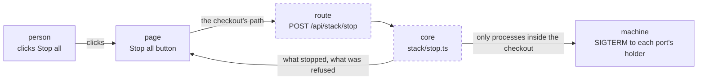

# Feature map

The feature-map branch of [`idea-interview`](SKILL.md): the recap as a Mermaid diagram of the
layers the feature runs through and what travels between them, in a markdown file the issue
carries.

The monitor's own feature map (PLAN.md § Feature map, step 5) isn't built yet, so the diagram is
written by hand. Once step 5 lands, with its blocks and its `draw` command, this branch moves to it.

## 1. Sketch

List the **pieces** and **arrows** before writing any Mermaid.

- **Pieces** are what the feature adds or changes, in the order it runs, starting from the person.
  A layer it passes through untouched gets a piece only where the flow wouldn't read without it.
  Most features are 4 to 10 pieces.
- Each piece has a **kind**, one of this repo's layers, and a **label**, what it is in this feature
  in a few words:

  | Kind      | Where it lives                                |
  | --------- | --------------------------------------------- |
  | person    | the user at the page, or an agent over MCP    |
  | page      | `web/`                                        |
  | route     | `server/routes.ts`                            |
  | core      | `core/<module>/`                              |
  | MCP tool  | `mcp/`                                        |
  | config    | `stack-monitor.json`, `core/config/schema.ts` |
  | machine   | git, `ps`, `lsof`, `docker`, launchd          |
  | agent run | a headless agent session in a worktree        |

- A piece whose layer isn't in the tree yet (`mcp/`, or a `core/` module PLAN.md hasn't reached) is
  **planned**. It goes in only where a Decided line needs it, and you say so in chat: the map then
  depends on a step that hasn't landed.
- A **note** on a piece is the Decided line that lands on it, then any Still open item on it as
  "Open: …".
- **Arrows** say what travels or happens: "asks to remove", "git worktree remove". The flow ends
  with an arrow back to what the person sees.

**Done when** every Decided line that changes the flow is a piece, an arrow or a note.

## 2. Draw

Write `<scratchpad>/<slug>.feature-map.md`:

````markdown
## Feature map: Stop a checkout's services



### How it flows

1. **person** → **page**: clicks
2. …

### Pieces

- **core: stack/stop.ts**: Refuses a port held outside the checkout. Open: how long it waits.
````

- Ids are `n1`, `n2`… in flow order. A node's text is `"<kind><br/><label>"`, quoted.
- In any text, write `"` as `#quot;`, `<` as `#lt;` and `>` as `#gt;`: unescaped, they end the
  label or read as HTML.
- Planned pieces get the dashed `planned` class; leave both `planned` lines out when there are none.
- **How it flows** is one numbered line per arrow, in flow order. **Pieces** has a line only for a
  piece with a note.

**Done when** the file has the diagram, every arrow under How it flows, and every note under Pieces.

## 3. Show

The terminal doesn't render Mermaid, so in chat give the How it flows list and the Pieces notes,
then the file's path. Say that GitHub renders the diagram once it's in the issue. Ask whether the
map is right; a correction is an edit to the file, then show it again.

**Done when** they've said it is. The file for the issue is that one.
