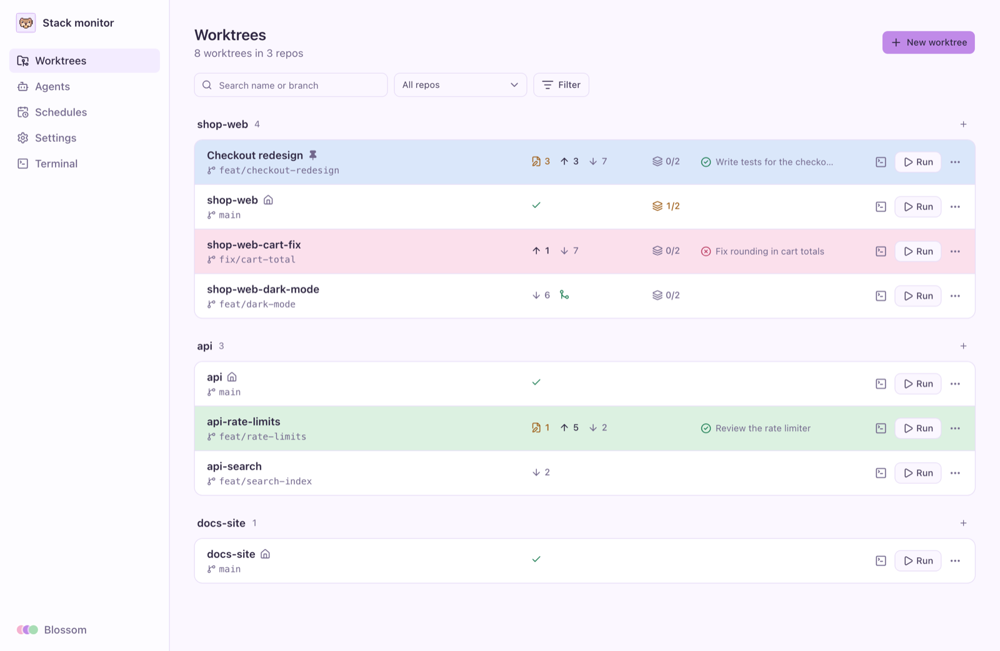
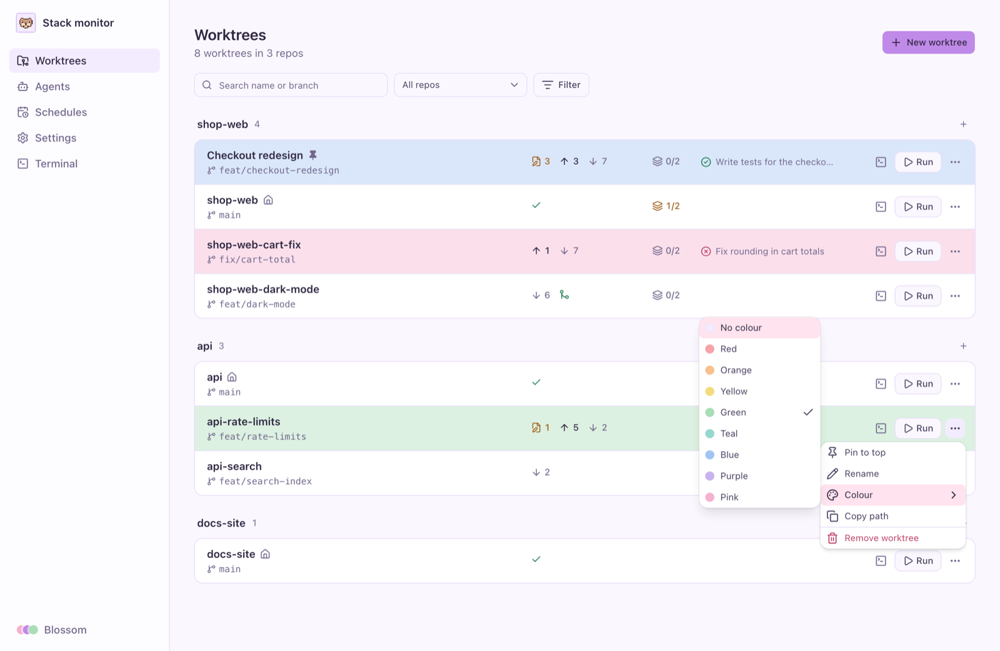
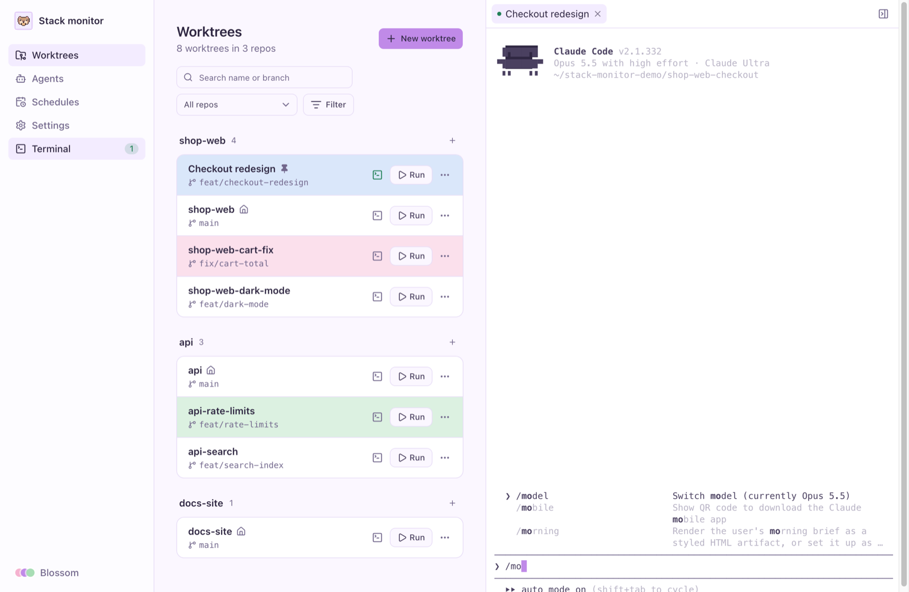
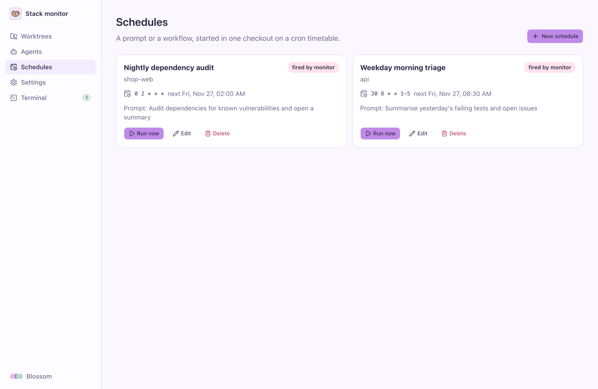
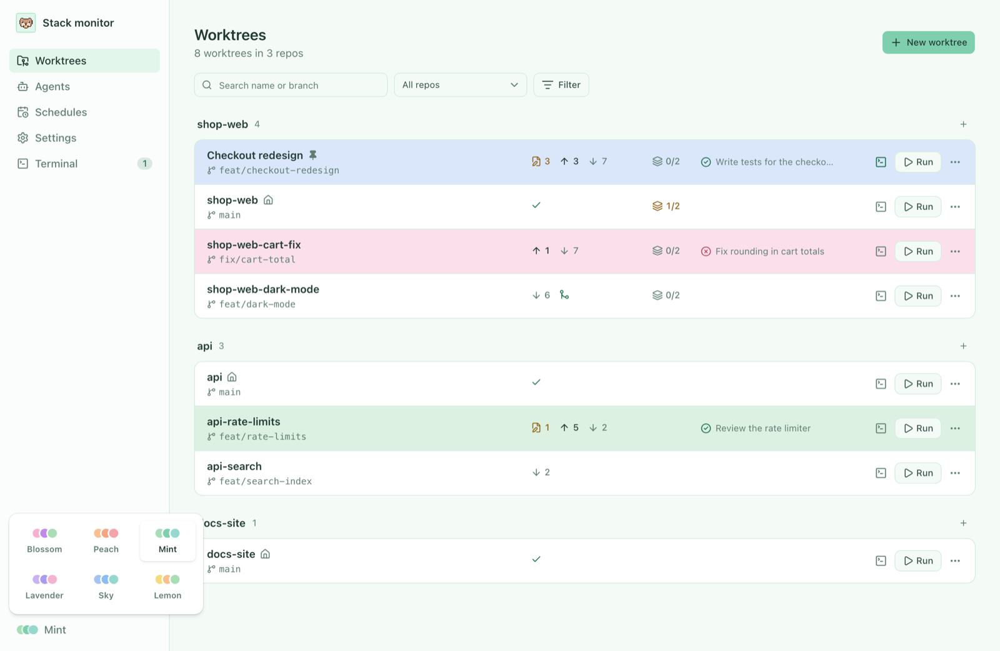

# stack-monitor


A local page and MCP server for working across a repo's git worktrees: each checkout's git state,
the dev stack it runs, and the coding agents working in it.

**Status: early, and in daily use.** Worktrees, the stack, agent runs, schedules, a Claude Code
terminal per worktree, a ticket board, and sessions that start on a ticket or a PR review are in;
the feature map comes next ([PLAN.md](PLAN.md)). It runs as a Mac
app (`mise run app`) or a local server you open in a browser.



**Every worktree, across the repos you care about.** One row per worktree, grouped by repo. Icons
say what you'd otherwise `git status` for, with words on hover: uncommitted files, commits ahead of
and behind main, merged, how much of its stack is up, and its last agent run. Pin the ones you're
on, rename them, and give them a colour.



**Claude Code in any worktree, without leaving the app.** The terminal icon on a row opens Claude
Code in that worktree, in a panel beside the page. It's the real `claude`, so `/model`, `/mcp`,
`/usage`, your skills and permission prompts all work, with a tab per session.



**Runs and schedules.** **Run** starts an agent or a workflow in a worktree and keeps its log. The
Schedules page runs one on a cron timetable: a nightly audit, a morning triage.



**Six pastel themes,** and the terminal follows whichever you pick.



## Install

It runs on macOS. You need git and [mise](https://mise.jdx.dev), which installs the Node it pins.

```sh
brew install mise                  # or: curl https://mise.run | sh
git clone https://github.com/npherrington/stack-monitor.git ~/code/stack-monitor
cd ~/code/stack-monitor
mise trust                         # mise asks before running a new repo's mise.toml
mise run dev                       # installs, builds the page, serves http://127.0.0.1:7420
```

Clone it outside `~/Desktop`, `~/Documents` and `~/Downloads`. macOS keeps background jobs out of
those folders, and the monitor's schedules and login job will run as launchd jobs from its folder.

**Add your repos.** Open **Settings** in the sidebar: add a repo by its path, or find the ones in
a folder (`~/code`, say) and tick them. The Worktrees page then shows every worktree of each. The
list lives in `~/.config/stack-monitor/.monitor.json` (`$STACK_MONITOR_SETTINGS` names another
file); until you first change it, the list is the repo the monitor started in.

```sh
STACK_MONITOR_REPO=~/src/myapp mise run dev   # start the list from another repo
STACK_MONITOR_PORT=7430 mise run dev          # another port, 1024 to 65535
```

**Agents.** The monitor runs the coding-agent CLIs you already use: Claude Code and OpenCode so
far. Install and log in to them as usual; Settings → Agents shows what it found. It stores no API
keys: to use your own provider key, or a local Ollama model, use it through OpenCode. A worktree's
**Run** starts a run in it, and the **Agents** page drafts skills and builds workflows, by default with
a free OpenCode model. Run logs live in `~/.local/state/stack-monitor/runs/`.

**Terminal.** A worktree's terminal icon starts `claude` in it, in a pseudo-terminal the monitor
keeps, shown in the Terminal panel (the sidebar's **Terminal** shows and hides it). Hiding the
panel or reloading the page comes back to the same session; quitting the monitor ends them. It
finds `claude` the way runs do, and opens only in a worktree of a repo you track.

The Workflows tab also lists a repo's Claude Code workflows: each `.claude/workflows/<name>.js`
whose `export const meta` names it, started as `claude -p` asking the Workflow tool to run it. A
`<name>.json` manifest (`label`, `description`, and optionally `argument`, `argumentLabel`,
`testRun`, `sessions`, `cost`, `effort`) with an executable `<name>.sh` beside it makes the launcher
what runs instead, given `--no-publish`, `--effort=`, `--notes=` and the argument, then `--` and
claude's flags. The monitor runs a launcher only as committed at the checkout's HEAD.

**Schedules.** The Schedules page starts a prompt or a workflow in one checkout on a cron line
(local time). Each schedule is fired either by launchd, as a LaunchAgent in
`~/Library/LaunchAgents` that fires whether the monitor is running or not, or by the running
monitor, which checks each minute and skips a time it was off for. Saving a launchd schedule first
checks that launchd can read the checkout: macOS keeps LaunchAgents out of `~/Desktop`,
`~/Documents` and `~/Downloads` unless node has Full Disk Access, and the page says so and offers
the monitor instead. A fire while a run is going in the checkout starts nothing and is logged as
skipped. Schedules and their fire log live in `~/.local/state/stack-monitor/schedules/`.

**Ticket board.** Under Product management, a board of tickets per project: columns you name,
colour and reorder, cards you drag between and within them, and a prefix you choose for each
project's ids (`BEANS-12`). A ticket has a markdown description, labels (shared by every project
or one project's own), a priority, a due date and comments; the board filters by label and
priority and searches titles and ids. Tickets and projects can be archived and restored, or
deleted for good. It's all in one SQLite file, `~/.local/state/stack-monitor/board.db`, or the
file `STACK_MONITOR_BOARD` names: copy it to back the board up or move it to another machine.

Two buttons on the board open Claude Code with the board's tools. **Work this ticket** (a card's
menu, or the ticket) asks which repo, a new worktree or one you have, and which of the repo's
skills to use (`work-ticket` when it has one), then starts the session on the ticket: the agent
reads it, moves it to In progress and comments as it goes. **Product management** starts a session
that interviews you, reads the code and files tickets into the project. Filing and commenting
don't ask first; changing or moving a ticket does. The board refreshes while such a session is
open.

**Agentic review.** On a PR in the GitHub page, **Agentic review** asks where to review (a new
review worktree, which the monitor puts at the PR's head on no branch, or a checkout you pick),
which skill to use (`peer-code-review` when the repo has it) and what to look at hardest, then
opens Claude Code there with the PR's details in its first message. Reading the PR on GitHub runs
without asking. The agent finishes by posting one review, headed "Agentic review", with its
findings as line comments; the monitor never approves that post for you, so Claude Code asks first
unless your own permission mode lets it through. A fork's PR is never checked out: its review
worktree stays on the base branch and the agent reads the PR's commits from there, so the PR's own
`CLAUDE.md`, skills, hooks and settings never load.

**MCP.** `mcp/main.ts` is a stdio MCP server with the board's tools: `board_list_projects`,
`board_list_tickets`, `board_get_ticket`, `board_create_ticket`, `board_update_ticket`,
`board_move_ticket` and `board_add_comment`. Sessions the monitor starts from the board get it
without setup. For your own sessions: `claude mcp add stack-monitor -- node <clone>/mcp/main.ts`.
Nothing in it deletes a ticket or starts a run.

Pins, names and colours you give worktrees, the filters, and the pastel theme (picked in the
sidebar) are kept per browser.

**Open it as an app.** `mise run app` opens the monitor as a Mac app (Electron) with the beaver
in the Dock, running the server itself; closing the window keeps it running until you quit. A change
to the page rebuilds and reloads the window; a change to `core/` or `server/` needs a restart. It
uses the same port as `mise run dev`, and shows that monitor if one is already running. A signed
download comes later; it won't be on the App Store, whose sandbox can't run git and agent CLIs
across your disk.

`mise run install-app` puts **Stack monitor.app** in `~/Applications`, so from then on it opens
from Spotlight, Launchpad or the Dock with no terminal. It's a launcher for your checkout: it runs
`mise run app` there with the PATH of the terminal you installed it from, and logs to
`~/Library/Logs/Stack monitor/app.log`. Run it again after moving the checkout; to remove it, move
the app to the Bin.

**Update.** `git pull`, then `mise run dev` again: it installs and rebuilds what changed.

The server answers only on 127.0.0.1, and only requests whose Host is `127.0.0.1` or `localhost`
on its port.

## Configure a repo

A repo says what it runs in `stack-monitor.json`. The monitor looks for it in this order:

1. the file `STACK_MONITOR_CONFIG` names
2. `stack-monitor.json` at the root of the repo's primary checkout
3. `~/.config/stack-monitor/<primary checkout's directory name>.json`, for a repo you'd rather not
   commit it to (`$XDG_CONFIG_HOME` is respected)

With no file at all, the defaults apply: worktrees and the feature map are on, stack and agents
off. [`examples/node-postgres.json`](examples/node-postgres.json) uses every section. Point
`$schema` at [`schema/stack-monitor.schema.json`](schema/stack-monitor.schema.json) for completion
and hover docs in your editor:

```json
{
  "$schema": "https://raw.githubusercontent.com/npherrington/stack-monitor/main/schema/stack-monitor.schema.json"
}
```

## Develop

```sh
mise run check               # everything CI runs: oxlint, eslint, prettier, tsc, actionlint, shellcheck, tests, the page build
mise run test                # tests/, with Node's own test runner
mise run format              # prettier --write
mise run schema              # rewrite the JSON Schema after changing core/config/schema.ts
mise run icon                # redraw the beaver into public/ after changing scripts/draw-icon.ts
mise run worktree -- try-1   # a linked worktree beside this one, to give the monitor more checkouts
```

`mise run worktree -- <branch>` checks out a local branch, tracks one that's only on origin, or
cuts a new one from a freshly fetched `origin/main`. The worktree lands beside the primary checkout
as `stack-monitor-<branch>`, with its dependencies installed. It prints how to serve and remove it.

`core/`, `server/` and `mcp/` are `.ts` files that Node runs directly by stripping their types, so
only the page (`web/`, React + Vite) is built.

## License

[MIT](LICENSE)
